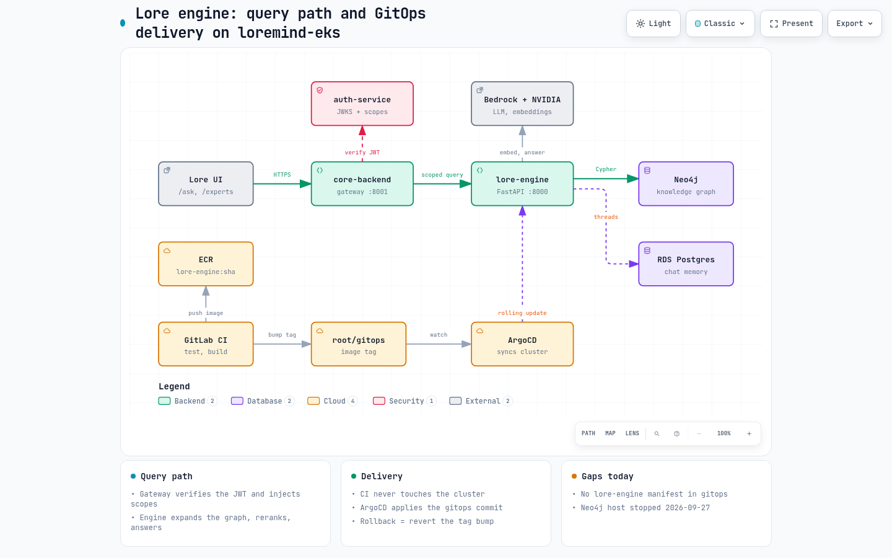

# Deploying lore-engine to loremind-eks (GitOps)

Interactive version: `img/lore-engine-eks.html`.

Flow: merge to `main` → GitLab builds `loremind/lore-engine:<sha>` → CI bumps the `"image"` line in
`root/gitops/apps/<env>/lore-engine.yaml` → ArgoCD syncs → rolling update. CI never touches the cluster.
Manual **deploy-production** job = promote.  Rollback = revert the bump commit in gitops.

## State on 2026-10-06 (read-only AWS checks)
| Piece | State |
|---|---|
| Image `loremind/lore-engine` | exists: `bb6010d3` (= `latest`/`stable`, 2026-09-25) |
| SSM secrets `/loremind/lore-engine/*` | exist: NEO4J_PASSWORD, NVIDIA_API_KEY, BEDROCK_API_KEY, INTERNAL_AUTH_SECRET, RBAC_INTERNAL_SECRET, MEMORY_POSTGRES_URI |
| gateway → engine | already wired: core-backend `AI_SERVER_URL=http://lore-engine:8000` |
| gitops manifest | **missing** (`apps/{staging,prod}/lore-engine.yaml` → 404); draft in `deploy/gitops/lore-engine.yaml` |
| ECS services | `lore-engine`, `lore-engine-staging` desired=0 (old platform) |
| Neo4j | was `bolt://15.206.15.12:7687` = EC2 `loremind-ec2` (m6a.large, 30 GB), **stopped 2026-09-27** |
| Postgres memory | RDS `loremind-lore-data-{prod,staging}` available; memory tables never migrated (engine runs `alembic upgrade head` on boot) |
| lore-frontend | knowledge-graph pages (/ask, /experts…) removed from main; live only on branch `demo-2026-07-06-save` |

## Steps and effort
1. **Neo4j** (decision): start `loremind-ec2` (~$0.10/h) *or* run Neo4j in-cluster (StatefulSet + restore `neo4j_data.tar.gz`, 1.3 GB). Open 7687 from the EKS node security group only. ~1–2 h.
2. **Fix the data** against that Neo4j: `reembed_graph` (~25 min) + `backfill_gmail_scopes` (~10 min). Without the re-embed every query fails (HTTP 410, model retired). ~1 h, run over VPN/SSH tunnel.
3. **Secrets**: confirm `INTERNAL_AUTH_SECRET` equals core-backend's `AI_SERVER_INTERNAL_SECRET` (compare without printing). 15 min.
4. **Manifest**: copy `deploy/gitops/lore-engine.yaml` to `apps/staging/lore-engine.yaml` (staging first; `EMBEDDING_MODEL` already switched), MR to root/gitops. ArgoCD applies. 30 min + review.
5. **Verify**: `kubectl -n staging rollout status deploy/lore-engine` (VPN), `/api/health`, one query through the gateway.
6. **Promote** with the manual job. Add `apps/prod/lore-engine.yaml`.
7. **UI**: restore the /ask pages from `demo-2026-07-06-save` into lore-frontend (not covered above). 1–2 days.

## Risks
- Prod graph vectors are from the retired model: must re-embed (step 2).
- Memory DB role needs CREATE on schema `memory` for the boot migration.
- The old task definition carried demo credentials (`AUTH_USERS`) and `QUERY_OPEN_ACCESS=true`; both deliberately **not** copied. Without open access the gateway must send scopes (`scope_ids`/`super_admin`) or every answer is empty.
- Neo4j was reachable on a public IP; the draft uses the private IP `10.0.1.65` (assumption: EKS shares the VPC).
- Could not run `kubectl`/ArgoCD from this machine (needs the VPN), so the manifest is validated for structure only, not applied.
